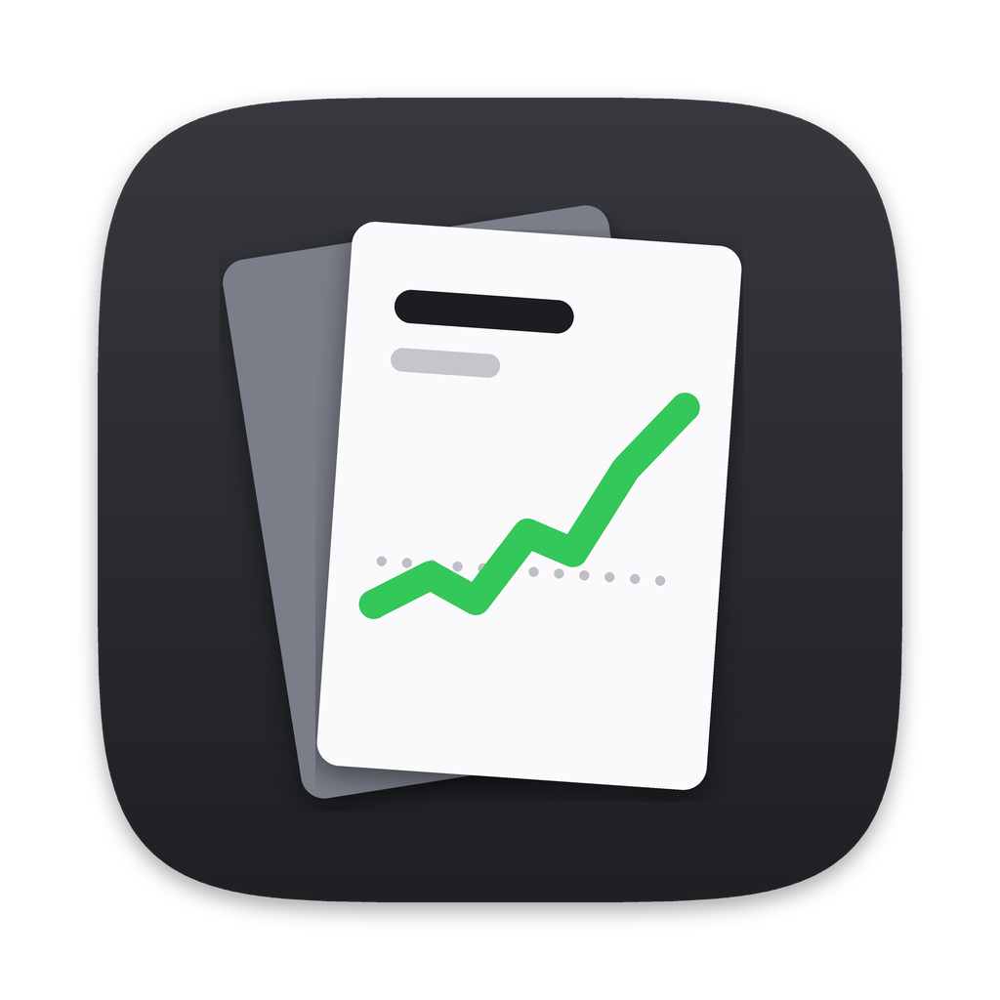

<p align="center"></p>

<h1 align="center">CardStock</h1>

<p align="center">Follow the prices of the Magic and Pokémon cards you care about, the way Stocks follows shares. A Mac app and desktop widgets.</p>

> Early work in progress. The plan, design and roadmap are in [docs/PLAN.md](docs/PLAN.md).

## What it does

- **A watchlist of specific cards.** Each entry is one printing in one finish, like *Sheoldred, the Apocalypse · Dominaria United · Foil*. Search and filter it by game.
- **Price, change and a chart.** Today's price, the change since yesterday, and a chart for 1W, 1M, 3M, 6M, 1Y or All. Hover over the chart to see the price on any day.
- **Your collection's value.** Enter how many copies you own and what you paid, and see what they're worth and your gain or loss.
- **Price alerts.** Get a notification when a card rises above or falls below a price you choose.
- **Widgets.** One card (pick one, or it shows your biggest mover), your watchlist, or your collection's value.
- **Dollars or euros.** USD prices come from TCGplayer and EUR prices from Cardmarket.
- **Export** your watchlist as a CSV spreadsheet, and buy links to TCGplayer and Cardmarket for every card.

## Where prices come from

| Game | Source | Notes |
| --- | --- | --- |
| Magic | [Scryfall](https://scryfall.com/docs/api) | Free, no key. TCGplayer and Cardmarket prices, updated daily. |
| Pokémon | [TCGdex](https://tcgdex.dev) | Free and open source, no key. TCGplayer and Cardmarket prices, updated daily. |

CardStock only uses these public APIs, which allow this use. It doesn't scrape any store. Neither source gives price history, so CardStock records each card's price once a day from the day you add it, and the charts fill in over time. The full reasoning, and the sources we decided against, are in the [plan](docs/PLAN.md#2-data-sources-and-legality).

## Keyboard shortcuts

| Shortcut | Action |
| --- | --- |
| ⌘N | Add Card |
| ⌘R | Refresh Prices |
| ⌘F | Search the watchlist |
| ⌘C | Copy the selected card's name and price |
| Delete | Remove the selected card (⌘Z to undo) |
| ⌘1 – ⌘6 | Chart range 1W, 1M, 3M, 6M, 1Y, All |
| ⇧⌘E | Export the watchlist as CSV |
| ⌃⌘S | Show or hide the sidebar |
| ↑ ↓ then Return | Choose a search result and add it |

## Install

Requires macOS 14 Sonoma or later.

**Download:** open the latest run under [Actions → cardstock](../../actions/workflows/cardstock.yml) and download the `CardStock` artifact. Unzip it and drag `CardStock.app` into Applications. It isn't notarized yet, so the first time, right-click it and choose **Open**.

That build is signed ad hoc, so the app works but the widgets can't see its data. For working widgets, build it yourself with your Apple developer team (below).

**Build it yourself** (needs Xcode 16 or later and [XcodeGen](https://github.com/yonaskolb/XcodeGen)):

```sh
brew install xcodegen
cd CardStock
xcodegen                 # creates CardStock.xcodeproj from project.yml
open CardStock.xcodeproj
```

To get the widgets working, select the CardStock project in Xcode, then for both the **CardStock** and **CardStockWidget** targets open *Signing & Capabilities*, choose your team and set signing to *Development*. The app and widget share data through an App Group named after your team ID. You can also set `DEVELOPMENT_TEAM` in `project.yml` so you don't have to set it again after regenerating.

## Project layout

| Path | What's there |
| --- | --- |
| `project.yml` | The Xcode project definition (XcodeGen) |
| `App/` | The SwiftUI app: model, watchlist, detail and chart, search, settings |
| `Widget/` | The WidgetKit extension: small card widget, medium and large watchlist widgets |
| `Shared/` | Views used by both: sparkline, change pill, card artwork |
| `Packages/CardStockKit/` | Everything that isn't UI: models, Scryfall and TCGdex clients, storage, price history maths, formatting |
| `Packages/CardStockKit/Tests/` | Unit tests, with saved API responses as fixtures |
| `Tools/render_icon.py` | Draws the placeholder app icon |
| `docs/PLAN.md` | Product plan, data sources, architecture, design and roadmap |

Run the tests with:

```sh
swift test --package-path Packages/CardStockKit
```

CardStock isn't affiliated with Wizards of the Coast, Nintendo, The Pokémon Company, TCGplayer, Cardmarket, Scryfall or TCGdex.
